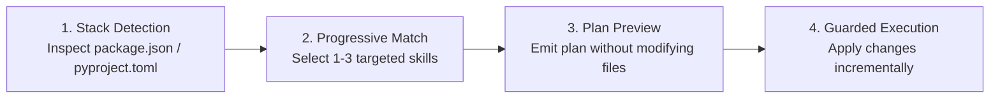

> 📌 **PIPELINE MARKER — FASE 0: VALIDAÇÃO DE STACK & CONTROLE (READ-ONLY)**
> *Posição no Fluxo:* Início obrigatório de qualquer tarefa. Proibido mutar arquivos antes do plano.
> *Guia Mestre de Orquestração:* Consulte [AGENTS.md](../AGENTS.md) para ordem de execução e precedência.

# Agentic Awesome Skills: Control Plane & Catalog Orchestration

> "Having 3,000 skills is dangerous if you dump them all into the context window, causing catastrophic context bloat and hallucinated triggers. This skill provides the AAS Core control-plane methodology: stack validation, progressive disclosure, and the strict separation of investigation from remediation."

---

## 1. The Context Bloat Problem & Progressive Disclosure

**Never load an entire massive skill catalog into the agent's active prompt.**

Follow the **Progressive Disclosure Pipeline**:



### 1. Technology Stack Validation First
Before proposing or applying any skill:
- **Inspect Manifests:** Read `package.json`, `pyproject.toml`, `Cargo.toml`, or `go.mod`.
- **Verify Installed Versions:** Never assume React 19 if `package.json` specifies React 18. Never assume Tailwind v4 if the project is on Tailwind v3.
- **Respect Conventions:** Follow existing project folder patterns (e.g., `src/`, `app/`, `features/`) rather than forcing personal structural dogmas.

### 2. Targeted Role-Based Bundles
Instead of browsing thousands of skills, choose from curated sub-bundles:
* **The Essentials:** `systematic-debugging`, `spec-driven-development`, `atomic-commits`.
* **Frontend Systems:** `component-design`, `responsive-layout`, `wcag-accessibility`.
* **Backend & API:** `rest-api-design`, `database-migrations`, `rate-limiting`.
* **DevOps & Cloud:** `docker-containerization`, `github-actions-ci`, `health-checks`.

---

## 2. Hard Separation: Investigation vs. Remediation

A major failure mode of coding agents is modifying code while still diagnosing the problem.

### Rule: The Two-Phase Firewall

```text
╔══════════════════════════════════════════════════════════════════════╗
║  PHASE 1: INVESTIGATION (READ-ONLY)                                  ║
║  - Read files, search codebase, run read-only diagnostics            ║
║  - Gather concrete evidence (log lines, stack traces, AST checks)    ║
║  - PROHIBITED: Calling edit_file, write_file, or mutating code       ║
╚══════════════════════════════════════════════════════════════════════╝
                                  │
                       [Formulate Action Plan]
                                  │
                                  ▼
╔══════════════════════════════════════════════════════════════════════╗
║  PHASE 2: REMEDIATION (MUTATION WITH CONFIRMATION)                   ║
║  - Present the specific proposed diff to the user                     ║
║  - Apply minimal targeted modifications                              ║
║  - Run regression verification immediately after edit                ║
╚══════════════════════════════════════════════════════════════════════╝
```

---

## 3. Evidence-Backed Codebase Navigation

When searching through large repositories:
1. **Locate Before You Read:** Use targeted grep/find commands on file paths and symbols instead of reading entire 500-line files blindly.
2. **Read Bounded Slices:** Read specific line ranges (`L100-L150`) around the target function to conserve token budget.
3. **Trace In-Memory State:** Trace function arguments from caller to receiver before claiming a variable is undefined.

---

## 4. The Plan Preview Protocol

Before touching any production file, output a standardized **Action Plan Preview**:

```markdown
### 📋 Proposed Action Plan: [Task / Bugfix]

1. **Root Cause Evidence:**
   - File: `src/auth/jwt.ts:42`
   - Issue: Expiration check uses `Date.now()` (ms) against JWT `exp` (seconds).

2. **Target Files to Modify:**
   - `src/auth/jwt.ts` (1 file, ~4 lines modified)
   - `tests/auth/jwt.test.ts` (1 test added)

3. **Verification Command:**
   - `npm test tests/auth/jwt.test.ts`

4. **Rollback Plan:**
   - `git checkout -- src/auth/jwt.ts`
```

Only after the plan is formulated and approved should the agent proceed to mutate code.
