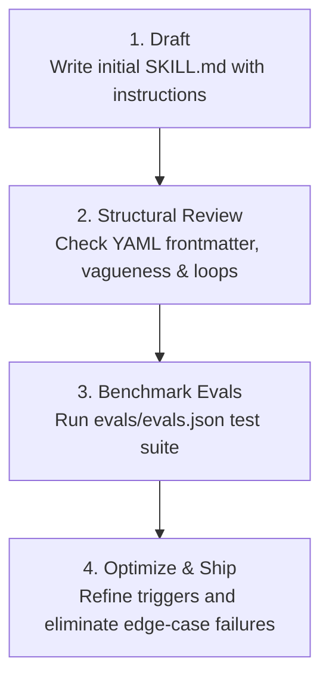

> 📌 **PIPELINE MARKER — FASE 6: META-SKILL (CRIAÇÃO & EVALS - SOB DEMANDA)**
> *Posição no Fluxo:* Ativado apenas para criar, calibrar ou testar novas skills com suites de teste.
> *Guia Mestre de Orquestração:* Consulte [AGENTS.md](../AGENTS.md) para ordem de execução e precedência.

# Anthropic Skill Creator: The Official Meta-Skill Standard

> "A skill is only as good as its triggers and its evaluations. This meta-skill defines the official Anthropic standard for authoring new skills, calibrating trigger descriptions to eliminate over/under-triggering, and running automated benchmark evaluations (`evals.json`)."

---

## 1. Anatomy of a Production-Grade `SKILL.md`

Every skill must have a standardized, clean structure:

```markdown
---
name: kebab-case-skill-name
description: Clear, specific summary of what the skill does AND when to use it. Include negative guidance to prevent mis-triggering.
---

# Skill Title

## 1. Purpose & Scope
- High-level objective and domain boundary.
- When this skill should activate vs. when it should NOT activate.

## 2. Step-by-Step Operating Instructions
- Ordered, procedural steps (1, 2, 3...) written with active imperative verbs.
- Concrete decision trees for branching logic.

## 3. Negative Constraints (What NOT to do)
- Explicit forbidden behaviors and common anti-patterns.

## 4. Expected Output Format
- Exact markdown, JSON, or code schema the agent must return.
```

---

## 2. Trigger Calibration: Preventing Over/Under-Triggering

The `description` field in the YAML frontmatter is the **routing gate** that models read during tool/skill selection:

### ❌ Bad Description (Too Vague - Causes Over-Triggering)
```yaml
description: Helps with testing and code quality.
```
*Problem:* Hijacks every conversation mentioning the word "test" or "code", wasting tokens and cluttering context.

### ❌ Bad Description (Too Specific - Causes Under-Triggering)
```yaml
description: Runs Jest unit tests on user authentication controllers in TypeScript.
```
*Problem:* Fails to activate if the user asks to test payments, Python code, or integration routes.

### ✅ Calibrated Description (Balanced Intent + Boundaries)
```yaml
description: Enforces Test-Driven Development (TDD) for new features and bugfixes. Activates when authoring unit/integration tests or implementing features test-first. Do NOT use for general code reviews or manual exploratory testing.
```

---

## 3. The 4-Stage Skill Creation Lifecycle



### Stage 1: Draft
* Identify a recurring engineering, design, or review workflow.
* Write concrete operational steps rather than vague philosophical advice (e.g., instead of *"write good code"*, specify *"ensure every public method has typed parameters and runtime null checks"*).

### Stage 2: Review (Auditing for Vague Adjectives)
* Search the draft for vague adjectives: *clean*, *proper*, *robust*, *careful*, *reasonable*.
* **Replace every vague adjective with an objective testable constraint:**
  - Replace *"Write robust error handling"* with *"Wrap all I/O calls in try/catch and map to typed ApplicationError instances"*.
  - Replace *"Ensure proper spacing"* with *"Use Tailwind 4px/8px rhythm (`gap-2`, `gap-4`)"*.

### Stage 3: Benchmark Evaluations (`evals/evals.json`)
Before trusting a skill, benchmark it against a baseline (agent running without the skill):

```json
{
  "skill_name": "tdd-workflow",
  "evals": [
    {
      "id": "eval-01-failing-test-first",
      "prompt": "Implement a function that calculates compound interest with monthly deposits.",
      "expected_artifacts": ["tests/interest.test.ts", "src/interest.ts"],
      "grading_assertions": [
        "Did the agent author the test file before the implementation file?",
        "Does the test cover zero-deposit and negative interest rate edge cases?",
        "Did all tests execute and pass green?"
      ]
    }
  ]
}
```

### Stage 4: Optimize & Ship
* Run automated or manual evaluation comparisons:
  - **Pass Rate:** Did the skill increase task success rate?
  - **Token Overhead:** Did the skill instructions consume unnecessary tokens?
* Strip repetitive prose and keep only actionable directives.
