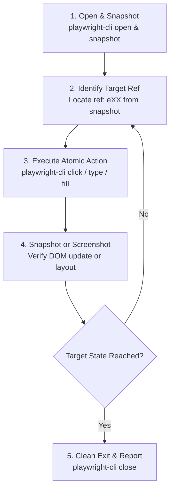

> 📌 **PIPELINE MARKER — FASE 4: AUTOMAÇÃO & PROVA REAL NO NAVEGADOR**
> *Posição no Fluxo:* Execução e validação interativa no browser oficial via CLI com economia de tokens.
> *Guia Mestre de Orquestração:* Consulte [AGENTS.md](../AGENTS.md) para ordem de execução e precedência.

# Playwright CLI: Token-Efficient Browser Automation for Agents

> "Traditional browser automation dumps giant accessibility trees and DOM dumps into the agent's context, wasting thousands of tokens per step. Microsoft's Playwright CLI uses local daemon-backed snapshots and concise element references (`refs`), allowing agents to test, navigate, and take screenshots with maximum token efficiency."

---

## 1. Core Concept: Ref-Based Snapshots

Instead of parsing entire HTML trees, the agent executes commands against a **lightweight accessibility snapshot** saved locally:

```text
- button "Submit Order" [ref: e14]
- textbox "Email" [ref: e15] value="user@example.com"
- link "Privacy Policy" [ref: e16]
```

The agent interacts deterministically by targeting the specific reference ID:
```bash
playwright-cli click e14
```

---

## 2. CLI Command Matrix

### A. Navigation & Sessions
* `playwright-cli open <url>`: Opens a URL in headless mode (starts the daemon if not running).
* `playwright-cli open <url> --headed`: Opens the browser in a visible window (ideal for visual debugging).
* `playwright-cli goto <url>`: Navigates the active page to a new URL.
* `playwright-cli reload`: Reloads the active page.
* `playwright-cli close`: Closes the current session and stops background browser daemons.

### B. Inspection & Snapshotting
* `playwright-cli snapshot`: Generates and prints the compact YAML accessibility snapshot with element `ref` IDs.
* `playwright-cli inspect <selector>`: Prints detailed attributes, computed styles, and bounding box of a target.

### C. Deterministic Element Interaction
* `playwright-cli click <ref>`: Clicks an element by its snapshot reference (e.g., `playwright-cli click e12`).
* `playwright-cli type <ref> "<text>"`: Types text with keystroke events into a target input.
* `playwright-cli fill <ref> "<text>"`: Clears and fills an input field instantly.
* `playwright-cli press <key>`: Simulates a keypress (e.g., `Enter`, `Tab`, `Escape`, `ArrowDown`).
* `playwright-cli select <ref> "<value>"`: Selects an option from a `<select>` dropdown.
* `playwright-cli hover <ref>`: Hovers over an element to reveal tooltips or dropdown menus.

### D. Visual Verification & Proof
* `playwright-cli screenshot`: Captures a viewport screenshot and saves to default artifacts.
* `playwright-cli screenshot --path <filepath>`: Saves a screenshot to a specific destination path.
* `playwright-cli screenshot --full-page`: Captures the full scrollable page height.

---

## 3. Agent Operating Protocol (The 5-Step Loop)

When assigned a browser verification, form submission, or testing task, the agent MUST follow this loop:



### Example Agent Session:
```bash
# 1. Open the local dev server
playwright-cli open http://localhost:3000

# 2. Get the active snapshot
playwright-cli snapshot

# 3. Fill out login form based on refs
playwright-cli fill e4 "testuser@company.com"
playwright-cli fill e7 "SecretPass123!"
playwright-cli click e9

# 4. Verify transition to dashboard
playwright-cli snapshot
playwright-cli screenshot --path ./dashboard-verified.png

# 5. Clean up
playwright-cli close
```

---

## 4. Best Practices & Safety

1. **Token Conservation:** Never ask for raw HTML or full DOM dumps. Rely strictly on `playwright-cli snapshot`.
2. **Process Hygiene:** Always run `playwright-cli close` when finished with a test session to prevent orphaned Chromium processes from consuming host memory.
3. **Handling Flaky Waits:** If a page transition involves asynchronous data fetching, wait for navigation before snapshotting:
   ```bash
   playwright-cli wait-for-load-state networkidle
   ```
4. **Converting to Permanent E2E Tests:** When the agent confirms a manual sequence works via CLI, it should codify the steps into a permanent Playwright test file (`tests/e2e/[feature].spec.ts`):
   ```typescript
   import { test, expect } from '@playwright/test';

   test('user can log in successfully', async ({ page }) => {
     await page.goto('http://localhost:3000');
     await page.getByLabel('Email').fill('testuser@company.com');
     await page.getByLabel('Password').fill('SecretPass123!');
     await page.getByRole('button', { name: 'Log In' }).click();
     await expect(page.getByRole('heading', { name: 'Dashboard' })).toBeVisible();
   });
   ```
