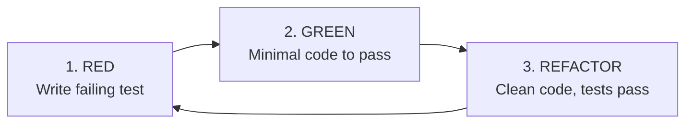

> 📌 **PIPELINE MARKER — FASE 1 & 2: ESPECIFICAÇÃO & TDD**
> *Posição no Fluxo:* Entrevista inicial (`/grill-me`), geração de `SPEC.md`, tickets atômicos e ciclo Red-Green-Refactor.
> *Guia Mestre de Orquestração:* Consulte [AGENTS.md](../AGENTS.md) para ordem de execução e precedência.

# Skills for Real Engineers

> "An AI coding agent should not be a reckless code generator. It must operate as a disciplined software engineer: stress-testing assumptions upfront, writing specs, decomposing work into tracer bullets, adhering to TDD, and debugging methodically."

---

## 1. Phase 1: Pre-Code Interrogation (`/grill-me` & `/grill-with-docs`)

**Never jump straight into writing code on non-trivial tasks.**

Before writing implementation code:
1. **Stress-Test Assumptions:** Ask the user targeted, relentless architectural questions:
   - What are the explicit non-goals?
   - What existing systems, APIs, or database schemas will this touch?
   - What happens on failure/edge cases (network timeout, empty data, invalid payload, concurrency)?
   - Are there backward compatibility constraints?
2. **Ground in Primary Documentation:** If third-party libraries or internal APIs are involved, verify against actual documentation or type definitions rather than hallucinating API signatures.
3. **Resolve Branches:** Do not proceed until every branching architectural decision has an agreed-upon answer.

---

## 2. Phase 2: Specification First (`/to-spec`)

Transform user discussions and ambiguous requirements into a structured **Technical Specification (`SPEC.md`)**:

```markdown
# Technical Specification: [Feature Name]

## 1. Context & Motivation
Why is this being built? What problem does it solve?

## 2. Goals & Non-Goals
- **Goals:** Measurable outcomes required for success.
- **Non-Goals:** What we are explicitly NOT doing in this iteration.

## 3. Architecture & Data Flow
- Component structure and module boundaries.
- Data models, schemas, and state transitions.

## 4. API & Interface Contracts
- Function signatures, TypeScript types/interfaces, HTTP/RPC contracts.

## 5. Failure Modes & Edge Cases
- How errors are caught, transformed, logged, and surfaced to users.
```

---

## 3. Phase 3: Task Decomposition (`/to-tickets`)

Break down the approved specification into small, atomic, verifiable **Tracer-Bullet Tickets**:

* **Atomic Scope:** Each ticket should represent a single verifiable unit of work (ideally 1–2 files modified).
* **Clear Verification Criteria:** Every ticket must state:
  - What files will be created/modified.
  - What test will prove this ticket is finished.
  - Dependencies on previous tickets.
* **Order of Execution:**
  1. Ticket 1: Core domain types & interfaces.
  2. Ticket 2: Pure domain logic (unit tested).
  3. Ticket 3: Infrastructure / Adapter / Data layer.
  4. Ticket 4: UI / Controller / Entrypoint integration.
  5. Ticket 5: End-to-end verification.

---

## 4. Phase 4: Test-Driven Development (`/tdd`)

Enforce the strict **Red-Green-Refactor Cycle**:



1. **Step 1 (RED):** Write a focused unit or integration test that asserts the desired behavior. Run the test suite and confirm it **fails for the expected reason** (not due to syntax error or misconfigured imports).
2. **Step 2 (GREEN):** Write the simplest, most minimal production code that makes the test pass. Do not write premature optimizations or unneeded abstractions.
3. **Step 3 (REFACTOR):** Clean up the implementation: eliminate duplication, improve variable naming, extract helper functions. Ensure all tests still pass green.
4. **No untested code:** If a feature or edge case isn't covered by a test, it does not exist.

---

## 5. Phase 5: Systematic Debugging (`/diagnose`)

When an unexpected bug or test failure occurs, **never make random guesses or blindly modify code**.

Follow the scientific debugging protocol:
1. **Reproduce:** Write a minimal failing test that reproduces the bug reliably.
2. **Isolate:** Trace the execution path. Identify the exact boundary where expected state diverges from actual state.
3. **Hypothesize:** Formulate one clear hypothesis about the root cause:
   > *"Hypothesis: The token expiry check compares milliseconds with seconds, causing valid tokens to appear expired."*
4. **Validate & Fix:** Apply the minimal targeted fix.
5. **Mutation Check:** Ensure the fix resolves the failing reproduction test without causing regressions in any other test.

---

## 6. Phase 6: Dual-Axis Code Review (`/code-review`)

Review changes across two distinct, independent axes:

* **Axis 1: Specification Adherence**
  - Did we meet all goals specified in `SPEC.md`?
  - Did any non-goals leak into the pull request?
  - Are all edge cases handled as agreed?
* **Axis 2: Code Quality & Engineering Standards**
  - **Type Safety:** No unneeded `any`, `unknown` cast without runtime validation, or unsafe non-null assertions (`!`).
  - **Modularity:** Are module interfaces small and deep (simple API surface hiding internal complexity)?
  - **Error Ergonomics:** Are errors specific, actionable, and typed?
  - **Side Effects:** Are pure business calculations isolated from I/O and network operations?

---

## 7. Phase 7: Session Continuity (`/handoff`)

When pausing or ending a long working session, generate a **Handoff Document (`HANDOFF.md`)**:
* **Current State:** What was completed in this turn.
* **In-Flight Task:** The exact ticket/test currently being worked on.
* **Next Immediate Step:** The exact next action the incoming agent or developer should take.
* **Blockers / Gotchas:** Non-obvious nuances or environmental quirks discovered.
