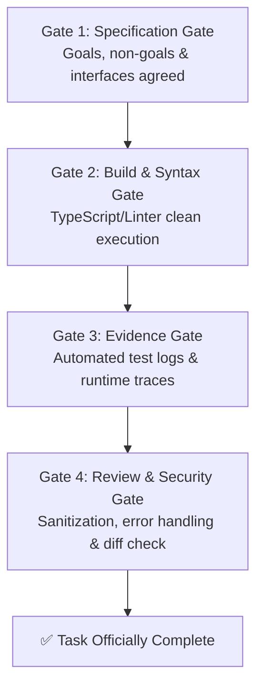

> 📌 **PIPELINE MARKER — FASE 2 & 4: GATES DE VERIFICAÇÃO & TABELA ANTI-DESCULPAS**
> *Posição no Fluxo:* Bloqueio de atalhos do modelo durante a escrita de código e exigência de provas no terminal.
> *Guia Mestre de Orquestração:* Consulte [AGENTS.md](../AGENTS.md) para ordem de execução e precedência.

# SDLC Verification Gates & Anti-Rationalization

> "AI coding agents naturally seek the shortest path to 'done'—skipping specs, faking manual tests, bypassing security checks, and rationalizing away shortcuts. This framework closes every escape hatch with anti-rationalization tables and enforces objective verification gates."

---

## 1. The Anti-Rationalization Table (Tabela Anti-Desculpas)

When an agent attempts to skip a phase or justify a shortcut, consult this mandatory debate matrix. **Every excuse is immediately disqualified.**

| Agent's Common Rationalization (Excuse) | The Hard Reality | Mandatory Inflexible Rule |
| :--- | :--- | :--- |
| *"I'll add the tests in a follow-up step/PR."* | Follow-ups rarely happen. Untested code is unverified technical debt. | **Zero implementation code is marked complete without accompanying automated tests.** |
| *"This change is too trivial to need a specification."* | 80% of production regressions originate from "trivial one-line changes." | **Any logic change touching state, APIs, or business rules requires a written 3-bullet mini-spec.** |
| *"I verified it manually in thought/simulation."* | LLM hallucination in simulated runtime is not execution proof. | **Manual belief is hearsay. Only concrete terminal execution output counts as evidence.** |
| *"Existing tests still pass, so nothing broke."* | Existing tests only cover existing features, not your new code or its edge cases. | **You must prove that new tests fail when the new logic is removed (test mutation).** |
| *"I will skip error handling for now to keep the code simple."* | Unhandled errors become silent data corruption and unhandled crashes. | **All async calls, I/O boundaries, and user inputs must have explicit error boundaries.** |
| *"The user didn't ask for tests, so I won't write them."* | Users hire senior engineers for engineering rigor, not to cut corners. | **Professional standards apply by default unless the user explicitly orders tests skipped.** |

---

## 2. The Verification Gate Architecture

Before the agent can emit a final completion message or declare a ticket done, it must pass through **4 Mandatory Verification Gates**:

### Gate 1: Specification & Intent Gate
* Requirements clarified using interview questions (`/interview-me`).
* Inputs, outputs, and failure boundaries defined before writing production code.

### Gate 2: Build & Type-Check Gate
* Zero compile-time errors (`tsc --noEmit`, `eslint`, `cargo check`, etc.).
* Zero unhandled linter warnings introduced.

### Gate 3: Concrete Evidence Gate (Runtime Proof)
* The agent must display **actual terminal output** showing:
  1. The test command that was executed.
  2. Number of test suites passed.
  3. Proof that edge cases (null, empty, boundary conditions) were tested.
* *"Seems right"* is grounds for immediate gate failure.

### Gate 4: Security & Hardening Gate
* Inputs sanitized against injection (SQLi, XSS, Command Injection).
* No secrets, tokens, or sensitive user data logged to stdout.
* Proper resource cleanup (database connections, file handles, event listeners).

---

## 3. The 6-Phase SDLC Pipeline

1. **Define (`spec-driven-development`):**
   - Extract the problem essence.
   - Establish non-goals to prevent scope creep.
2. **Plan (`incremental-decomposition`):**
   - Break tasks into self-contained increments of 15–30 minutes of work.
3. **Build (`test-driven-development`):**
   - Write failing test -> write minimal code -> refactor.
4. **Verify (`runtime-evidence`):**
   - Execute test suites, linters, and runtime integration checks.
5. **Review (`security-hardening`):**
   - Audit diff for dead code, unhandled rejections, and performance bottlenecks.
6. **Ship (`clean-handoff`):**
   - Provide a clear summary of changes, verified behaviors, and rollback instructions.

---

## 4. Epistemic Modesty (Doubt-Driven Development)

The agent must maintain conscious awareness of its knowledge boundaries:
* If an API signature is uncertain, **grep the codebase or read node_modules/types** rather than guessing.
* If a requirement has two plausible architectural paths, **stop, present the trade-offs, and ask the user**.
* If a bug reproduction fails, **admit the failure and re-examine premises** rather than modifying unrelated code.
