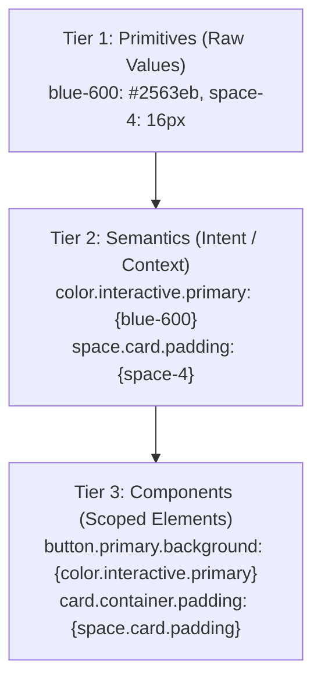

> 📌 **PIPELINE MARKER — FASE 3C: TOKENS DTCG & 50 GATES DE UI**
> *Posição no Fluxo:* Validação de tokens em 3 camadas, 6 estados interativos e conformidade WCAG 2.2.
> *Guia Mestre de Orquestração:* Consulte [AGENTS.md](../AGENTS.md) para ordem de execução e precedência.

# UX/UI Agent Skills: DTCG Tokens & Objective Quality Gates

> "Subjective aesthetic reviews fail because 'looks good to me' is unverifiable. This skill transforms coding agents into senior UI architects by establishing DTCG 3-tier token structures, 6-state interactive coverage, and 50 automated objective quality gates that fail builds when standards are violated."

---

## 1. DTCG 3-Tier Design Token Architecture

All UI styling must adhere strictly to the **Design Tokens Community Group (DTCG)** specification. Hardcoded hex colors, arbitrary pixel paddings, and magic numbers are strictly forbidden.



### Tier 1: Primitives (Global Values)
Raw constants with zero context:
```json
{
  "color": {
    "slate": {
      "900": { "$value": "#0f172a", "$type": "color" },
      "500": { "$value": "#64748b", "$type": "color" },
      "50": { "$value": "#f8fafc", "$type": "color" }
    },
    "indigo": {
      "600": { "$value": "#4f46e5", "$type": "color" },
      "700": { "$value": "#4338ca", "$type": "color" }
    }
  },
  "spacing": {
    "1": { "$value": "4px", "$type": "dimension" },
    "2": { "$value": "8px", "$type": "dimension" },
    "4": { "$value": "16px", "$type": "dimension" }
  }
}
```

### Tier 2: Semantics (Contextual Intent)
Tokens that convey purpose (light/dark mode switches happen here):
```json
{
  "color": {
    "surface": {
      "base": { "$value": "{color.slate.50}", "$type": "color" },
      "raised": { "$value": "#ffffff", "$type": "color" }
    },
    "text": {
      "primary": { "$value": "{color.slate.900}", "$type": "color" },
      "secondary": { "$value": "{color.slate.500}", "$type": "color" }
    },
    "action": {
      "primary": { "$value": "{color.indigo.600}", "$type": "color" },
      "primary-hover": { "$value": "{color.indigo.700}", "$type": "color" }
    }
  }
}
```

### Tier 3: Components (Scoped Properties)
Mapped directly to UI elements in Tailwind or CSS variables:
```json
{
  "button": {
    "primary": {
      "background": { "$value": "{color.action.primary}" },
      "background-hover": { "$value": "{color.action.primary-hover}" },
      "padding-x": { "$value": "{spacing.4}" }
    }
  }
}
```

---

## 2. The 6-State Interactive Element Rule

Every interactive element (button, input, select, card link, dropdown item) **MUST** implement and handle all 6 interactive states:

1. **Default:** Baseline resting state.
2. **Hover (`:hover`):** Obvious visual change (brightness shift, background tint, elevation shift).
3. **Focus-Visible (`:focus-visible`):** High-contrast 2px solid ring with 2px offset. Never remove outline without `:focus-visible` replacement.
4. **Active (`:active`):** Tactile push response (e.g., `transform: scale(0.98)` or deeper background).
5. **Disabled (`:disabled` / `aria-disabled="true"`):** Reduced opacity (0.5), cursor `not-allowed`, and pointer events disabled.
6. **Loading (`aria-busy="true"`):** Spinner or skeleton overlay, maintaining element dimensions to prevent layout shifts.

---

## 3. The 50 Objective UI Quality Gates

Before declaring any UI task done, the code must pass these critical objective checks:

### Accessibility & Contrast (WCAG 2.2 Standards)
- [ ] **Contrast Gate (Text):** All body text achieves at least **4.5:1** contrast ratio against its immediate background. Large text (24px+ or 18.5px bold) achieves at least **3:1**.
- [ ] **Contrast Gate (UI Controls):** Form borders, active icons, and focus indicators achieve at least **3:1** contrast against adjacent colors.
- [ ] **Touch Target Gate:** All clickable/tappable elements have a minimum interactive bounding box of **44x44px** (iOS HIG) or **48x48px** (Material/Android).
- [ ] **Touch Spacing Gate:** Minimum **8px physical gap** between adjacent touch targets to prevent accidental mis-taps.

### Layout Reflow & Responsive Boundaries
- [ ] **Extreme Viewport Gate:** Layout does not clip, overflow, or break at viewports from **280px (Galaxy Fold closed)** up to **2560px (4K desktop)**.
- [ ] **Horizontal Scroll Ban:** Zero unintended horizontal scrollbars at any responsive width.
- [ ] **Text Reflow (200% Zoom):** Page supports browser text zoom up to 200% without overlapping headers or clipped modals.
- [ ] **Line-Length Containment:** Prose and body paragraphs constrained to `max-w-prose` (60–75 characters per line).

### Form Ergonomics & Feedback
- [ ] **Label Associativity:** Every `<input>` has an explicit `<label htmlFor="...">` or `aria-label`.
- [ ] **Error Announcements:** Form errors linked via `aria-describedby` and marked with `role="alert"`.
- [ ] **Autofill Attributes:** Common inputs supply `autocomplete="email"`, `autocomplete="current-password"`, etc.

---

## 4. Multi-Framework Integration Rules

* **Tailwind CSS:** Map Tier 2 semantics to `tailwind.config.js` theme extensions using CSS variables:
  ```css
  :root {
    --color-surface-base: #f8fafc;
    --color-action-primary: #4f46e5;
  }
  .dark {
    --color-surface-base: #0f172a;
    --color-action-primary: #6366f1;
  }
  ```
* **Shadcn UI / Radix:** Wrap base primitives while preserving keyboard accessibility primitives (`ArrowKey` navigation in dropdowns, `Escape` to dismiss modals).
