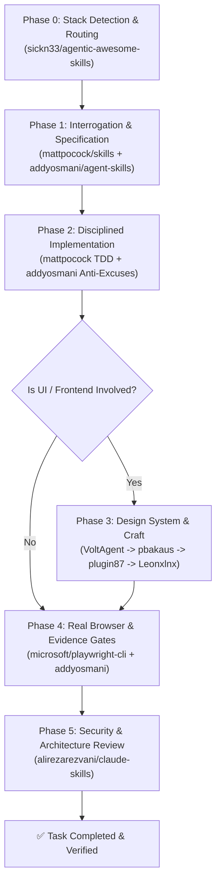

# 🧭 Master Agent Orchestrator & Execution Pipeline

> **CRITICAL DIRECTIVE FOR CODING AGENTS (Claude Code, Cursor, Antigravity, Copilot, Codex):**  
> When operating inside this workspace or utilizing these skills, **DO NOT load all skills at once.** Follow this sequential pipeline. Load only the specific skill required for your active phase.

---

## 🗺️ The 6-Phase Execution Pipeline

Every engineering or UI task must proceed sequentially through these phases:

---

## 📋 Phase-by-Phase Instructions for the AI

### 🔹 Phase 0: Stack Detection & Control Plane
* **Active Skill:** `sickn33/agentic-awesome-skills.md`
* **Agent Rule:** **READ-ONLY PHASE.** Do NOT modify code yet.
* **Actions:**
  1. Inspect `package.json`, `pyproject.toml`, `Cargo.toml`, or `go.mod`.
  2. Confirm library versions and established directory conventions.
  3. Formulate and present a **Plan Preview** before applying any file mutations.

---

### 🔹 Phase 1: Requirements Grilling & Specification
* **Active Skills:** `mattpocock/skills.md` (`/grill-me`, `/to-spec`, `/to-tickets`) + `addyosmani/agent-skills.md` (`spec-driven-development`)
* **Actions:**
  1. Run `/grill-me`: Interrogate the user on non-goals, failure modes, and boundaries.
  2. Generate `SPEC.md` documenting context, inputs, outputs, and edge cases.
  3. Break down work into small, atomic **Tracer-Bullet Tickets** (`/to-tickets`).

---

### 🔹 Phase 2: Disciplined Implementation (TDD)
* **Active Skills:** `mattpocock/skills.md` (`/tdd`) + `addyosmani/agent-skills.md` (Anti-Rationalization Table)
* **Agent Rule:** **Consult the Anti-Rationalization Table.** Never skip writing tests.
* **Actions:**
  1. **RED:** Write the failing unit/integration test first. Verify it fails as expected.
  2. **GREEN:** Write the minimal implementation code to pass the test.
  3. **REFACTOR:** Clean up code without breaking passing tests.

---

### 🔹 Phase 3: Design System & Frontend Craft (UI Tasks Only)
* **Active Skills (Sequential Order):**
  1. `VoltAgent/awesome-design.md`: Select the brand aesthetic preset (Linear, Stripe, Vercel, Notion, etc.).
  2. `pbakaus/impeccable.md`: Write tokens to `DESIGN.md` and define `PRODUCT.md`.
  3. `plugin87/ux-ui-agent-skills.md`: Enforce DTCG 3-tier tokens and mandatory 6-state interactive coverage.
  4. `Leonxlnx/taste-skill.md`: Apply art direction to eliminate generic AI-slop layouts.
  5. `pbakaus/impeccable.md`: Run aesthetic dials (`/polish`, `/bolder`, `/quieter`).

---

### 🔹 Phase 4: Browser Automation & Objective Quality Gates
* **Active Skills:** `microsoft/playwright-cli.md` + `plugin87/ux-ui-agent-skills.md` (50 Gates) + `addyosmani/agent-skills.md` (Evidence Gates)
* **Agent Rule:** **Always use Playwright CLI.** Do NOT run unverified custom browser scripts.
* **Actions:**
  1. Launch headless or headed browser via `playwright-cli open <url>`.
  2. Snapshot the page via `playwright-cli snapshot` and target elements using concise `ref: eXX`.
  3. Validate contrast (WCAG 2.2 AA), touch targets (min 44x44px), and viewport reflow down to 280px.
  4. Capture verification proof via `playwright-cli screenshot --path <filepath>`.

---

### 🔹 Phase 5: Security & Architecture Review
* **Active Skill:** `alirezarezvani/claude-skills.md`
* **Actions:**
  1. **OWASP Audit:** Verify input sanitization, parameterized queries, and authorization checks.
  2. **Secret Scan:** Ensure zero `.env` values, API keys, or private certificates exist in the git diff.
  3. **Complexity & Architecture:** Validate module boundaries and failure isolation.

---

### 🔹 Phase 6: Meta-Skill (Creating/Optimizing Skills Only)
* **Active Skill:** `anthropics/skills.md`
* **Trigger:** Activates ONLY when the user asks to create, refine, or benchmark a new agent skill.
* **Actions:** Calibrate trigger descriptions, eliminate vague adjectives, and build `evals/evals.json`.

---

## 🚨 Anti-Conflict & Precedence Rules

1. **Browser Automation Precedence:** `microsoft/playwright-cli` supersedes any browser scripts from other skills.
2. **Design Tokens Precedence:** `VoltAgent` supplies raw values -> `pbakaus` formats `DESIGN.md` -> `plugin87` enforces DTCG rules.
3. **Engineering Rigor Precedence:** `addyosmani`'s Anti-Rationalization Table overrides any tendency to skip tests or specs.
